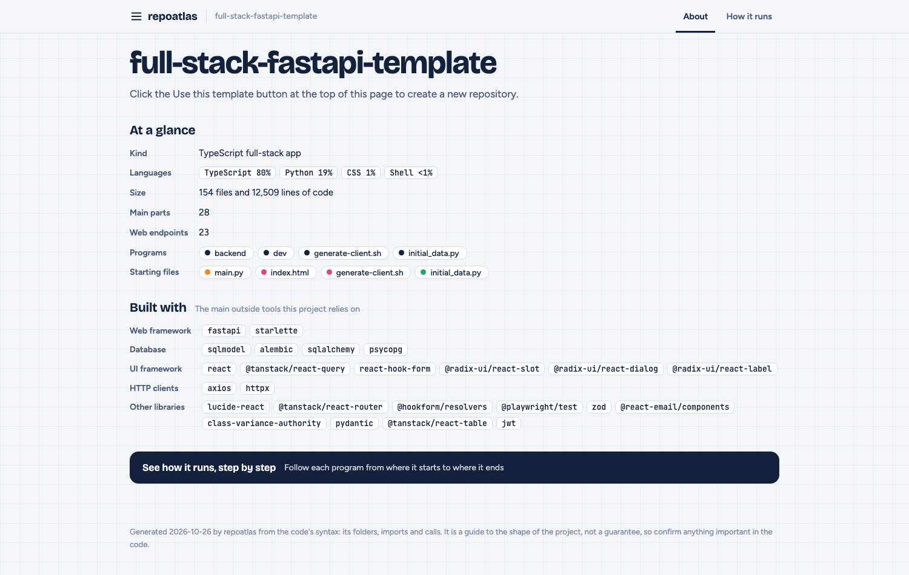

# repoatlas

**See how any codebase fits together, one layer at a time.**

Point `repoatlas` at a repository and it writes one self-contained HTML page: an atlas of the project. Start with the big picture, click any layer or part to zoom in, down to a single function. Then follow each program the project runs, step by step, from where it starts to where it ends. No server, nothing leaves your machine.



## Install

Needs [Rust](https://rustup.rs) (one command, no sudo) and git.

```sh
git clone https://github.com/FahimSifnatul/repoatlas.git
cd repoatlas
./install.sh
```

This builds a release binary and copies it to `~/.local/bin`, adding that folder to your `PATH` if needed. Open a **new terminal** and check:

```sh
repoatlas --version
```

The binary is self-contained, so the clone can be deleted afterwards.

| Task | Command |
|---|---|
| Install elsewhere | `REPOATLAS_INSTALL_DIR=/usr/local/bin ./install.sh` |
| Leave shell startup files alone | `./install.sh --no-modify-path` |
| Update | `git pull && ./install.sh` |
| Uninstall | `./install.sh --uninstall` |

Prefer cargo? `cargo install --path .` puts it in `~/.cargo/bin`.

<details>
<summary><b>Without a clone</b></summary>

```sh
curl -fsSL https://raw.githubusercontent.com/FahimSifnatul/repoatlas/master/install.sh | sh
```

Downloads the release binary for your machine, checks its SHA-256, and installs it the same way. If no binary exists for your machine it builds from source (needs cargo). Pin a version with `REPOATLAS_VERSION=v2.0.0`.

macOS, Linux and WSL are supported by the script. On Windows, take `repoatlas-windows-x86_64.exe` from the [latest release](https://github.com/FahimSifnatul/repoatlas/releases/latest), or run `cargo install --git https://github.com/FahimSifnatul/repoatlas`.

</details>

## Use

```sh
repoatlas                                     # map the current folder
repoatlas ~/code/my-app                       # map another folder
repoatlas https://github.com/pallets/flask    # clone, map, clean up
repoatlas . -o map.html --no-open             # choose the file, skip the browser
```

| Option | Meaning |
|---|---|
| `-o, --out FILE` | output file (default `repoatlas.html`) |
| `--no-open` | do not open the result in a browser |
| `--scip FILE` | use a [SCIP](https://github.com/scip-code/scip) index for exact call matching |

The page is one file: email it, attach it, or commit it. A finished sample is [examples/example.html](examples/example.html).

## What you see

1. **About.** The home page: what the project is, its size and languages, web endpoints, the programs it runs and the files they start from, and the outside tools it is built with.
2. **A layer.** Every part of one layer (interface, entry points, logic, data...), with lines showing who uses whom. Hover a box to follow its connections.

   

3. **Parts, files, functions.** Click down to classes, functions and web endpoints, and which files rely on them.
4. **How it runs.** One journey per program the project runs (web server, worker, scheduler...), starting where the project itself says it starts (a Dockerfile, a Procfile, a `package.json` script, `main()`). Each journey lists the functions called in order, nested under their callers, marked with what each step reads (arguments, environment, requests, files, database) and writes (output, responses, files, outside calls). Every web endpoint gets its own journey, with its full mounted path and the middleware that runs first. Pick one and its path lights up on the map; press Play to watch it travel.

   

Every box is clickable. Breadcrumbs, Back and `Esc` go up a level. The screenshots above come from [examples/example.html](examples/example.html).

## Languages

Read with [tree-sitter](https://tree-sitter.github.io), so comments and strings are never mistaken for code.

| Language | Finds | Import links |
|---|---|---|
| Python | classes, functions, routes | packages, relative imports, `src/` layouts, console scripts |
| JavaScript, TypeScript, Vue, Svelte | classes, functions, components, routes | relative paths, aliases, index files, workspaces |
| Go | functions, methods, structs, interfaces | `go.mod` modules, package-shared names |
| Java, Kotlin | classes, objects, methods | package and class names |
| Rust | structs, enums, traits, `impl` methods | `mod`, `use crate::...` |
| C, C++ | structs, classes, functions | local `#include "..."` |
| Ruby, PHP, C#, Swift, Scala | classes, methods, functions | class and function names a file uses |
| Shell | functions | scripts it sources or runs |
| HTML, CSS | interface layer | `<script src>`, `href`, `@import` |

A call is matched to a function by language-neutral rules, most certain first: same class, a class named in the call, a written-out path, a named import, a variable of known type, the same file, imported files, the same package, then the only function with that name. Calls into outside libraries are left out. Only when every rule fails does it fall back to the receiver's name, and that step is drawn dashed and labelled as a guess.

repoatlas has no built-in knowledge of any framework. How a project starts comes from its Dockerfile, compose and Kubernetes files, CI YAML, Procfile, Makefile, supervisor/systemd files, and `package.json` / `composer.json` / `pyproject.toml` scripts. What links to what comes from imports, calls, and paths or class names written in strings. Frameworks are recognised from the libraries imported.

Missing a language? See [CONTRIBUTING.md](CONTRIBUTING.md).

## Sharper matching with SCIP (optional)

For compiler-grade call matching, generate an index with the language's SCIP indexer and pass it in (or leave `index.scip` in the repository):

```sh
rust-analyzer scip .          # Rust
scip-python index .           # Python
scip-typescript index         # TypeScript / JavaScript
scip-java index               # Java, Kotlin, Scala
scip-go                       # Go
repoatlas . --scip index.scip
```

Where the index names a definition, it wins. Everything it does not cover keeps the normal rules. Index the whole project: a half-covered repo can lose guessed edges it should keep. The file is only read, never uploaded.

## Good to know

- **It reads code, it does not run it.** Dynamic imports, dependency injection and calls through outside libraries are invisible. Treat the map as a strong guide and confirm anything important in the code.
- **Fast.** Django (2,800 files, 460,000 lines) maps in 5 to 7 seconds on a laptop.
- **Deterministic.** The same repository always produces the same page.
- **Private.** Nothing is uploaded. The page asks Google Fonts for typefaces when online and falls back to system fonts offline.

## Contributing

Bug reports and new languages are welcome: see [CONTRIBUTING.md](CONTRIBUTING.md). Released under the [MIT License](LICENSE).
