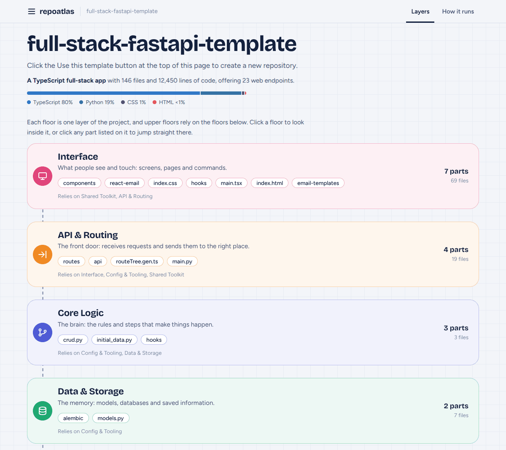
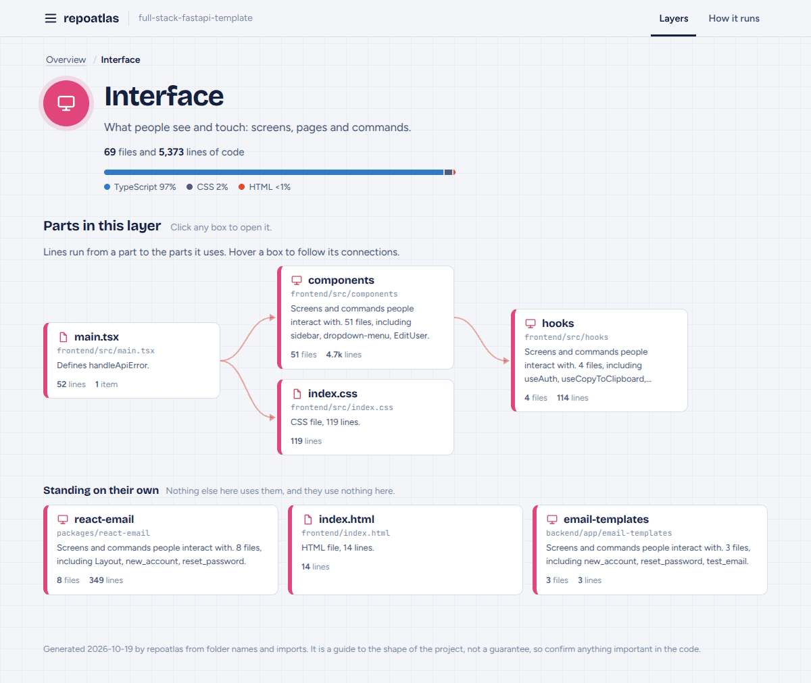
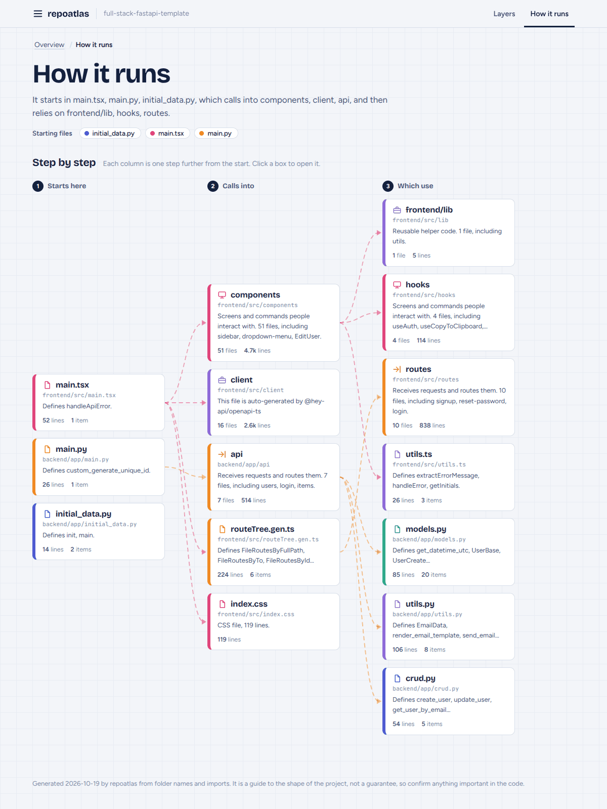

# repoatlas

**See how any codebase fits together, one layer at a time.**

Point `repoatlas` at a repository and it writes a single HTML page that works like an atlas of the project. Start with the big picture, click any layer or part to zoom in, and keep going down to a single function. No setup, no server, nothing leaves your machine.



## Install

macOS, Linux and Windows (WSL). No sudo needed:

```sh
curl -fsSL https://raw.githubusercontent.com/YOUR_GITHUB_USER/repoatlas/main/install.sh | sh
```

Then open a **new terminal window** and check it worked:

```sh
repoatlas --version
```

That is the whole install. It downloads **one file** into `~/.local/bin` and adds that folder to your `PATH` if it was not already there. Nothing else on your computer is touched, and you do not need to keep anything you downloaded. It needs Python 3.8 or newer, which most Macs and Linux machines already have. Python 3.8 through 3.14 are tested.

<details>
<summary><b>Other ways to install</b></summary>

**From a clone, then delete the clone.** Because `repoatlas` is a single self-contained file, the folder is not needed afterwards:

```sh
git clone https://github.com/YOUR_GITHUB_USER/repoatlas.git
cd repoatlas && ./install.sh
cd .. && rm -rf repoatlas
repoatlas --version          # still works
```

**Homebrew**

```sh
brew install YOUR_GITHUB_USER/tap/repoatlas
```

**pipx** (the route for Windows without WSL)

```sh
pipx install git+https://github.com/YOUR_GITHUB_USER/repoatlas
```

**A specific version, or another folder**

```sh
curl -fsSL https://raw.githubusercontent.com/YOUR_GITHUB_USER/repoatlas/main/install.sh | REPOATLAS_VERSION=v1.0.0 sh
curl -fsSL https://raw.githubusercontent.com/YOUR_GITHUB_USER/repoatlas/main/install.sh | REPOATLAS_INSTALL_DIR=/usr/local/bin sh
```

**Update:** run the install command again. **Uninstall:**

```sh
curl -fsSL https://raw.githubusercontent.com/YOUR_GITHUB_USER/repoatlas/main/install.sh | sh -s -- --uninstall
```

**Want to read the installer first?** It is one short file: [install.sh](install.sh). It also checks the download against a published checksum before installing it.

</details>

## Use

```sh
repoatlas                       # map the folder you are in
repoatlas ~/code/my-app         # map a project somewhere else
repoatlas https://github.com/pallets/flask    # map a repository straight from GitHub
repoatlas . -o map.html --no-open             # choose the file name, do not open the browser
```

It writes `repoatlas.html` and opens it in your browser. The file is self-contained, so you can email it, attach it to a ticket, or commit it next to the code.

## What you see

**1. The overview.** One floor per layer of the project: what people see, the front door, the brain, the memory, the phone lines to the outside world, the shared toolkit. Upper floors rely on the floors below them.

**2. Zoom into a layer.** Every part of that layer, with lines showing who uses whom. Hover a box to follow its connections.



**3. Keep going.** Click a part to see its folders and files, and a file to see its classes, functions and web endpoints, and exactly which files rely on it.

**4. How it runs.** The "How it runs" tab starts from the program's entry points and follows the imports step by step.



Every box is clickable. The breadcrumb, your browser's Back button and the `Esc` key all take you up a level.

A finished example is in [docs/example.html](docs/example.html): download it and open it in a browser.

## Languages

| Language | What it finds | Import links |
|---|---|---|
| Python | classes, functions, web routes | packages, relative imports, `src/` layouts, console scripts |
| JavaScript, TypeScript, Vue, Svelte | classes, functions, components, types, routes | relative paths, `@/` aliases, index files, workspace packages |
| Go | functions, structs, interfaces | module imports via `go.mod` |
| Java, Kotlin | classes, objects, functions | package and class names |
| Rust | public items | `mod` and `use crate::...` |
| C, C++ | structs, classes | local `#include "..."` |
| Ruby, PHP, C#, Swift, Scala | classes, functions | not followed yet |
| HTML, CSS | counted as the interface layer | none |

Missing yours? Each language is one small file, see [CONTRIBUTING.md](CONTRIBUTING.md).

## Good to know

* **It reads your code, it does not run it.** The layers come from folder and file names, the libraries a file imports, and its imports of other files. That is a very good guide to the shape of a project, not a guarantee, so confirm anything important in the code.
* **Dynamic imports and dependency injection are invisible** to a tool that does not run the program.
* **Nothing is uploaded.** The page does ask Google Fonts for its typefaces when you are online, and falls back to your system fonts when you are not.
* Output is deterministic: the same repository always produces the same page.

## Contributing

Bug reports and new languages are welcome. See [CONTRIBUTING.md](CONTRIBUTING.md). Maintainers: [docs/RELEASING.md](docs/RELEASING.md).

Released under the [MIT License](LICENSE).
